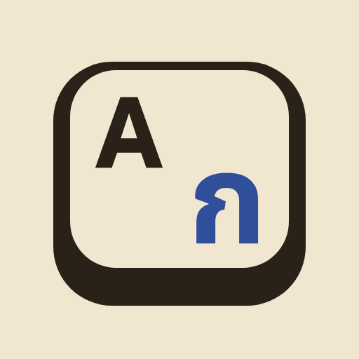

# Oops/Wrong Layout



Two small, dependency-free browser tools for a keyboard gone wrong. Everything runs in your browser: nothing you type is sent anywhere.

[](LICENSE)
[](https://developer.mozilla.org/en-US/docs/Web/JavaScript)
[](https://developer.mozilla.org/)


**[Open the site →](https://unknown-x0.github.io/OopsWrongLayout/)**

---

## What's in here

| Tool              | File          | What it does                                             |
| ----------------- | ------------- | -------------------------------------------------------- |
| **Layout Fix**    | `index.html`  | Undoes text typed in the wrong keyboard layout           |
| **Romaji → Kana** | `romaji.html` | Converts typed Japanese romaji into hiragana or katakana |

Both are static pages — open them directly in a browser, or serve the folder with anything. No npm install, no bundler, no framework.

Both pages share one interface:

- **The mechanism on screen.** Layout Fix shows a live **key map**: each key carries the character you typed (top-left) and the one you meant (bottom-right), and the keys your text used light up, the most-used one solid. Romaji → Kana shows a **kana chart** that lights the kana in your result.
- **Typed out, like a typewriter.** Pasted text types itself into the result while the matching keys strike; Copy confirms with a check and a small "Copied" slip.
- **Display settings.** Choose **Mode** (System, Light, Dark) and **Paper**, the coloring: Parchment, Carbon Copy, Ledger Green, Blueprint or Kraft, each with a light and a dark version. Both choices are remembered on your device.
- **Made for every screen.** On phones the keyboard splits into two half-boards; everything works by keyboard and with reduced motion.

---

## Layout Fix

Typed a whole sentence in the wrong keyboard layout and only noticed at the end? Paste the garbled result, tell it which two layouts were involved, and it reconstructs what you meant to type.

**How it works:** every layout table maps _physical key positions_ to characters. Converting a piece of text just means: for each character, find the physical key that produced it in the layout you were typing in, then read off what that same key produces in the layout you meant to use. It's the same trick tools like Punto Switcher use — no dictionaries, no guessing, purely mechanical and reversible.

```
"l;ylfu"  typed as US-QWERTY, meant as Thai   →  "สวัสดี"
"ghbdtn"  typed as US-QWERTY, meant as Russian →  "привет"
```

### Supported layouts

English (US QWERTY) · Thai (Kedmanee) · German (QWERTZ) · Russian (ЙЦУКЕН) · Ukrainian (ЙЦУКЕН) · French (AZERTY) · Spanish (QWERTY ES) · Hebrew

### Using it

1. Paste the garbled text into box **A**.
2. Set **Typed as** and **Should have been** to the two layouts involved. Each picker previews the layout's home-row keys (a s d f g on that layout).
3. The fix types itself out as you go, and the key map below lights up the keys your text used. Click **Auto-detect direction** if you're not sure which way round the layouts go.
4. Click **Copy**.

### Adding a layout

Every layout in `layouts.js` is two 47-character arrays — `unshifted` and `shifted` — lined up against the shared `SLOTS` physical-key order. Drop a new entry into the `LAYOUTS` object with your layout's characters in the same 47 positions and it shows up in both pickers and on the key map automatically. [STANDARDS.md](STANDARDS.md#layout-data) lists what a new layout ships with (tests, script detection, docs).

---

## Romaji → Kana

Type Japanese the way you would on any English keyboard; get proper kana back.

```
konnichiwa  →  こんにちは
kitte       →  きって      (doubled consonant → small っ)
gen'in      →  げんいん    (apostrophe forces an explicit ん)
kyuuto      →  キュート    (katakana contracts repeated vowels into ー)
```

Handles the standard Hepburn conventions: doubled consonants → small tsu, ん before a consonant or at word-end, `nn` / `n'` for an explicit ん before a vowel, and — in katakana only — repeated vowels contract into the long-vowel mark.

**Why no Mandarin pinyin?** Kana conversion works because romaji → kana is a direct, one-to-one mapping. Pinyin isn't: a single syllable maps to several unrelated Chinese characters (`ma` → 妈 / 麻 / 马 / 骂, depending on tone and meaning), so a real converter needs a dictionary and a candidate picker — a genuinely different kind of tool, not an extension of this one.

---

## Project structure

```
index.html        Layout Fix page
romaji.html       Romaji → Kana page (its page script is inline)
style.css         shared styling: five papers, each in light and dark
theme.js          Display settings: Mode and Paper
custom-select.js  styled layout pickers (the hidden <select> keeps the value)
typewriter.js     typed-out result, key strikes and Copy (both pages)
script.js         Layout Fix wiring and the key map
layouts.js        keyboard layout tables + conversion engine
kana-data.js      Hepburn romaji → kana lookup table
kana.js           romaji → kana conversion engine
icons/            keycap logo: favicon.svg plus PNG sizes
tests/            engine tests (Node's built-in runner)
```

## Project documents

| File | What it covers |
| --- | --- |
| [PRODUCT.md](PRODUCT.md) | Who the tools are for and what they must never claim |
| [DESIGN.md](DESIGN.md) | The visual system: tokens, type, components, motion |
| [STANDARDS.md](STANDARDS.md) | Engineering and quality rules, and the definition of done |
| [ROADMAP.md](ROADMAP.md) | Where the project is heading next |
| [NOTICE.md](NOTICE.md) | Third-party font and logo-glyph licences |

---

## Testing

The conversion engines have tests that run with Node 18 or newer and need no install:

```
node --test tests/*.test.cjs
```

They check that every layout covers all 47 keys with no duplicate characters, that each layout's characters survive a round trip through every other layout, the README's known words, pass-through of off-keyboard characters, and the Hepburn spelling rules. The interface is checked in Chromium and WebKit at phone, tablet and desktop widths; [STANDARDS.md](STANDARDS.md#definition-of-done) has the full definition of done.

If you change a mapping table, run the tests before opening a PR.

---

## Known limitations

- **Rare shifted symbols** (Thai tone-mark positions, German/French AltGr characters, Spanish accent/dead-keys) were built from reference material rather than verified on physical hardware and may be slightly off. A few obscure Thai shift-row slots use placeholder Thai punctuation (๛ ๏ ๚ ๎) where the true value wasn't reliably known — this keeps every key round-trip-safe instead of risking silent data loss on a guess.
- **Hebrew has no letter case.** Converting mixed-case Latin text through Hebrew and back loses capitalization (`Hello` and `hello` land on the same key) — this matches a real Hebrew keyboard, not a bug. The same applies to a few US shift-symbols (`:` `"` `<` `>`) whose physical keys are reassigned to Hebrew letters.
- **A couple of very common Japanese words** (こんにちは, こんばんは) are spelled with は rather than phonetic わ; these are handled as explicit whole-word exceptions since no phonetic rule can derive them. They apply only when the word is the whole input: inside a sentence, `konnichiwa` is spelled phonetically (こんにちわ).
- **The key map shows unshifted legends.** A shifted character (a capital letter, a Thai shift-row mark) lights the correct key, but the key shows its unshifted characters.

Spot something off? Open an issue or PR.

---

## Contributing

Read [STANDARDS.md](STANDARDS.md) first: it covers the module boundaries, the rules for layout and kana data, the interface rules, and the checks a change has to pass. Ideas for what to build next are in [ROADMAP.md](ROADMAP.md).

---

## License

MIT — see [LICENSE](LICENSE). Third-party font licensing is in [NOTICE.md](NOTICE.md).
